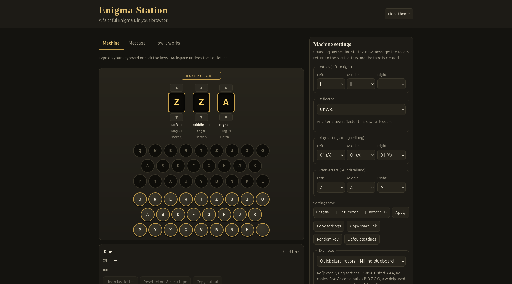

# Enigma Station

[**Try Enigma Station**](https://enigmastation.vercel.app/)

An educational, browser-based simulator of the **Enigma I**, the three-rotor machine used by the
German Army (Heer) and Air Force (Luftwaffe) in the Second World War. It runs entirely in the
browser, has **no dependencies and no build step**, and deploys as a static site.

Set the rotors, rings and plugboard, type on the keyboard, and watch the machine's internal state
change on every key press. The cipher engine is a separate, tested module, so what you see on screen
is exactly what the algorithm computes.



## Features

- **Machine tab.** Rotor windows with notch indicators, a lampboard that lights while a key is
  held, a keyboard you can click, touch or type on, an input/output tape in groups of five, undo
  (Backspace) and reset.
- **Rotor stepping you can see.** Rotors that moved on the last key press animate, and the signal-path
  panel says in words which rotors moved and why.
- **Signal path inspector.** All 11 stages of the last key press (keyboard, plugboard, three rotors,
  reflector, three rotors back, plugboard, lamp), with the letter entering and leaving each stage and
  the wiring contact inside each rotor.
- **Plugboard.** Click two letters to connect them, click a cabled letter to remove its cable.
  Up to 10 cables, with clear messages for clashes.
- **Settings.** Rotor order (choosing a rotor that is already fitted swaps the two), reflectors A, B
  and C, ring settings and start letters, a one-line settings text you can copy, edit and apply, a
  share link, a random key and a reset to defaults.
- **Message tab.** Encrypt or decrypt whole texts, with the output either keeping your layout or as
  five-letter groups, plus copy and "use output as input".
- **Examples.** Quick start, double step (step through it letter by letter), ring settings,
  plugboard, and the Barbarossa message.
- **How it works tab.** History and why sharing settings mattered, the signal path, the stepping
  rules with an interactive double-step demo, ring settings, the plugboard, the size of the key space,
  and what the simulator leaves out.
- Dark theme by default with a light theme toggle, responsive from phone to desktop, keyboard
  accessible with visible focus, screen-reader announcements for key presses, reduced-motion support.
- Remembers your last settings and theme in `localStorage`. If storage is blocked, the app works the
  same without it.

## Settings text and share links

Settings are written on one line and can be pasted back in:

```
Enigma I | Reflector B | Rotors II-IV-V | Rings 02-21-12 | Start BLA | Plugs AV BS CG DL FU HZ IN KM OW RX
```

The parser accepts any case, ring settings as numbers or letters (`02-21-12` or `BUL`), cables as
`AV`, `A-V` or `A/V`, and the German field names Walzenlage, Ringstellung, Grundstellung and
Steckerverbindungen. "Copy share link" puts the same text in the URL fragment (`#key=...`), which is
never sent to a server. Opening such a link loads those settings and takes priority over saved ones.

## Text handling

- The letters **A–Z in either case** are encrypted and always come out as capitals.
- **Everything else** (spaces, digits, punctuation, accented letters, other scripts, emoji, line
  breaks) is passed through unchanged and does **not** turn the rotors, so formatting is preserved.
- Nothing is transliterated: `ä` stays `ä`. The real machine had no digits or umlauts, and operators
  spelled them out.
- Grouped output (five-letter groups) keeps only the letters.

## Simulated machine

| Part | Included |
| --- | --- |
| Model | Enigma I (Army / Air Force) |
| Rotors | I, II, III, IV, V (three fitted, any order) |
| Notches | Q, E, V, J, Z, one per rotor (turnover at Q→R, E→F, V→W, J→K, Z→A) |
| Reflectors | UKW-A, UKW-B, UKW-C |
| Entry wheel | Straight-through (A→A, B→B, …) |
| Ring settings | 01–26 on all three rotors |
| Plugboard | Up to 10 cables |

Not included: the naval M3 and M4 (rotors VI–VIII, Beta, Gamma, the thin reflectors), the Abwehr,
commercial and Swiss machines. The app says so, and it does not imply
that this configuration represents every Enigma model.

## Tests

```bash
npm test               # same as: node --test tests/*.test.js
```

Requires Node 18 or newer and nothing else (the built-in test runner).
There are 65 tests covering the following:

- **Reference vectors.** `tests/fixtures/reference-vectors.json` holds 61 vectors (19,005 letters)
  generated by the independent [py-enigma](https://pypi.org/project/py-enigma/) package, not by this
  code. They cover every rotor, reflectors A, B and C, 0 to 10 cables, random ring settings and
  starts placed one step before a double step. See `tests/fixtures/README.md`.
- **Known answers.** `AAAAA → BDZGO` (rotors I-II-III, UKW-B, all at A), and a message that
  decrypts to German with its documented settings (the "Barbarossa message", rotors II-IV-V, rings
  02-21-12, start BLA, ten cables).
- **Properties.** Reciprocity (encrypting twice from the same start returns the message, including
  100,000-letter messages and a live machine that is reset between runs), no letter ever encrypts to
  itself, the rotor positions repeat after exactly 26 × 25 × 26 = 16,900 key presses, and reflectors
  are fixed-point-free involutions.
- **Stepping.** Single carry, double step (`ADU → ADV → AEW → BFX → BFY`), both notches engaged,
  rotor V wrapping Z → A, every rotor's notch, and ring settings never affecting stepping.
- **Edge cases.** Validation messages, malformed settings text and share links, empty input,
  punctuation, digits, accented letters and emoji.

## Implementation notes

### Project structure

```
index.html
css/styles.css           theme variables, layout, components
js/main.js               builds the interface, tabs, persistence, share links
js/core/                 pure logic: no DOM, storage or timers
  data.js                rotor, reflector and keyboard data
  enigma.js              validation, stepping, the machine, signal trace, key space
  text.js                message handling and output formatting
  config.js              settings text, share links, random key
  examples.js            ready-to-load configurations
js/ui/                   views: machine, plugboard, settings, message, inspector, learn, store
js/utils/                clipboard and safe localStorage wrappers
tests/                   node:test suites and reference vectors
```

### Design notes

- **Stepping is decided by the window letters, before the letter is encrypted.** The right rotor
  always steps. The middle rotor steps if the right rotor is on its notch **or** if it is on its own
  notch (the double step). The left rotor steps if the middle rotor is on its notch. Notches are cut
  into the lettered ring, so ring settings never affect stepping.
- **Ring settings** offset the wiring core from the window letter by `position − ring`. Each rotor's
  contact is therefore `forward[(c + offset) mod 26] − offset`, and the inverse table is used on the
  way back.
- **The engine returns the full signal trace** from the same code path that produces the output, so the
  inspector cannot disagree with the cipher. A test checks that the trace chains together, matches the
  output, and agrees with the documented wirings in both directions.
- **Configurations are validated and frozen** by `createConfig`, which reports every problem at once.
  The UI cannot reach an invalid state: rotor choices swap instead of duplicating, and the plugboard
  refuses an eleventh cable or a clashing letter.
- **Changing a setting starts a new message.** Rotors return to the start letters and the tape is
  cleared, because a tape recorded under other settings could not be reproduced. Turning a rotor with
  its arrows sets that window letter as the new start position.
- **All text is inserted as text nodes**, never as HTML, so nothing typed or pasted can become markup.
- **No dependencies.** The only npm file is `package.json` with two scripts.

## Known limitations

- Enigma I only (see above). Reflector A is checked structurally and through the same machine
  mechanics as B and C, but py-enigma ships no reflector A to compare against directly.
- Repeated keys from holding a physical key down are ignored, as on the real machine. Only one key
  is held at a time.
- The random key uses `Math.random`. This is a learning tool, not a way to protect secrets: Enigma has
  been broken for decades.
- Browsers that block `localStorage` or the clipboard still work. Settings just are not remembered,
  and copy buttons tell you when the browser refused.
- The interface is tested by hand in Chromium; there is no automated browser test suite in this
  repository, to keep it dependency-free.

## License

This project is licensed under the MIT License. See [LICENSE](./LICENSE).
